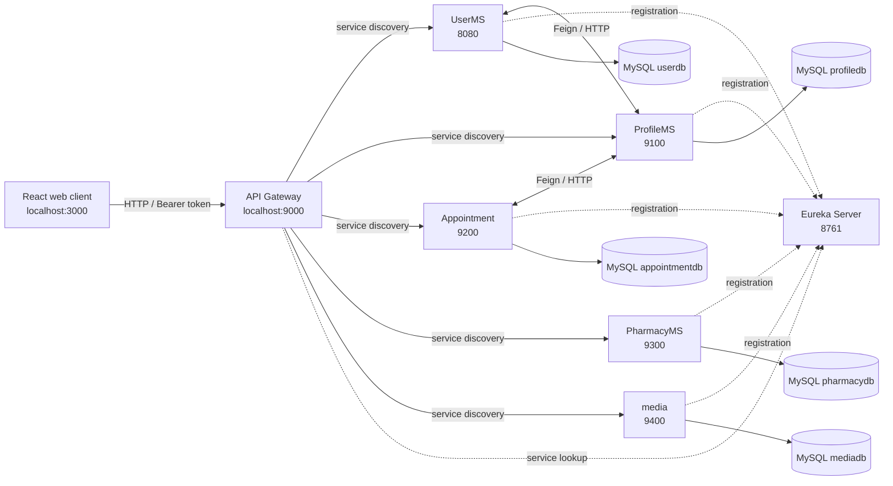

# Hospital Management System (HMS)

HMS is a role based hospital management application with a React/TypeScript web client and a set of Spring Boot services. It covers account registration and login, patient and doctor profiles, appointment scheduling and clinical records, medicine inventory and sales, and profile image/media uploads.

This repository is organized as a source workspace rather than a single deployable build: each backend service is its own Maven project, and the frontend is its own Create React App project. The services use MySQL and discover each other through Eureka; the frontend sends API traffic through the Spring Cloud Gateway.

## Contents

- [Architecture](#architecture)
- [Repository layout](#repository-layout)
- [Services and responsibilities](#services-and-responsibilities)
- [Request and data flows](#request-and-data-flows)
- [Technology stack](#technology-stack)
- [Prerequisites](#prerequisites)
- [Configuration](#configuration)
- [Run locally](#run-locally)
- [Frontend structure](#frontend-structure)
- [API overview](#api-overview)
- [Persistence and data ownership](#persistence-and-data-ownership)
- [Security notes](#security-notes)
- [Containers](#containers)
- [Troubleshooting](#troubleshooting)

## Architecture



The browser calls one public backend origin, the gateway at `http://localhost:9000`. Gateway route prefixes select a service (`/user/**`, `/profile/**`, `/appointment/**`, `/pharmacy/**`, and `/media/**`). The gateway uses Eureka (`lb://...`) to resolve service instances, so service URLs can be supplied through environment variables when service discovery is not used. Eureka is a registry, not a proxy: services register there and the gateway looks them up.

Each business service owns its own schema and persistence layer. Services that need related data call one another over HTTP (including OpenFeign clients); they do not share JPA entities or a single database schema. The React application is a separate client and does not connect directly to MySQL.

## Repository layout

```text
.
├── Backend/
│   ├── Eureka-Server/   # Service registry
│   ├── GatewayMS/       # External API gateway and JWT filter
│   ├── UserMS/          # Accounts, login, registration, JWT creation
│   ├── ProfileMS/       # Patient and doctor profiles
│   ├── Appointment/     # Appointments, reports, prescriptions
│   ├── PharmacyMS/      # Medicines, inventory, sales
│   └── media/           # Profile/media upload and retrieval
└── Frontend/            # React + TypeScript single-page application
```

Most Java services follow a layered layout: `api` contains REST controllers, `service` contains use-case/business logic, `repository` contains Spring Data persistence interfaces, `entity` maps database records, and `dto` defines API/service data shapes. `config` holds framework/security/client configuration, and `utility`/`exception` contain shared error handling within that service. Not every service has every package.

## Services and responsibilities

| Component | Default port | Main responsibility |
| --- | ---: | --- |
| Frontend | 3000 | Role-specific user interface, routing, state, and API calls |
| GatewayMS | 9000 | Routes API traffic, applies the JWT token filter, and enables gateway CORS |
| Eureka-Server | 8761 | Registry for backend service instances; dashboard at `http://localhost:8761` |
| UserMS | 8080 | User accounts, registration/login, role data, and JWT issuance |
| ProfileMS | 9100 | Doctor and patient demographic/profile data |
| Appointment | 9200 | Appointment lifecycle, clinical reports, prescriptions, and visit data |
| PharmacyMS | 9300 | Medicine catalog, stock/inventory, and sales records |
| media | 9400 | Multipart media upload and retrieval (max request/file size configured as 10 MB) |

The service names matter to Eureka routing. In particular, the configured application names are `UserMS`, `ProfileMS`, `Appointment`, `PharmacyMS`, and `media` (lowercase). Gateway route destinations should match those registered names.

There is a configuration mismatch in the current media route: the media service registers as `media`, while GatewayMS defaults to `lb://meda`. Set `MEDIAMS_URL` to the actual reachable media service URL (or align the registered name and route) for media calls to work through Eureka-based routing.

### Backend layers

- **REST API/controller**: Maps HTTP paths and verbs to operations and binds request/response DTOs.
- **DTOs**: Keep wire formats separate from JPA entities and are also used for service-to-service calls.
- **Service interfaces and implementations**: Coordinate validation, repository work, and calls to other services.
- **Repositories and entities**: Persist service-owned data with Spring Data JPA and Hibernate.
- **Configuration and clients**: Configure security/CORS, WebClient, Eureka, and Feign integrations.
- **Exception handling**: Service exceptions and controller advice shape errors returned from the service.

## Request and data flows

### Login and authenticated requests

1. The React `UserService` calls `POST /user/login` through the Axios instance, whose default base URL is the gateway.
2. The gateway route applies `TokenFilter`. Login and registration are specially allowed through without a bearer token.
3. UserMS validates the credentials and returns a token. The frontend stores the token in local storage and Redux state.
4. Axios adds `Authorization: Bearer <token>` to subsequent requests. The frontend's protected routes also check whether Redux has a token before rendering role pages.
5. The gateway validates the JWT before forwarding protected routes. The backend services also have Spring Security configuration; review each service's rules when changing access behavior.

### Registration and profiles

Account registration is handled by UserMS. UserMS uses a ProfileMS client for profile-related operations. The profile service owns doctor and patient records, while the account service owns credentials and account/role details. This separation means a user and their corresponding profile are related through identifiers and API calls rather than a shared database table.

### Appointments and clinical records

Appointment manages scheduling, cancellation, visit counts, reports, and prescriptions. It calls ProfileMS when it needs profile data such as doctor or patient information. A typical clinical workflow is: patient schedules an appointment, doctor reviews it, the appointment is completed with a report, and prescriptions can then be viewed by patient or doctor.

### Pharmacy

PharmacyMS owns the medicine catalog, inventory quantities, and sales/line items. It is a separate service from Appointment, which stores prescription information. The UI exposes pharmacy management to administrators and medicine/appointment-related views to doctors.

### Media

The media service accepts multipart uploads and returns media identifiers/data through its API. The frontend includes a protected image hook/component for displaying media. Upload and retrieval pass through the gateway like other APIs.

## Technology stack

- **Frontend**: React 18, TypeScript, Create React App (`react-scripts`), React Router, Redux Toolkit, Axios, Mantine, PrimeReact, Recharts, and Day.js.
- **Backend**: Java 17, Spring Boot, Spring Web, Spring Data JPA/Hibernate, Spring Security, Bean Validation, Spring Cloud Gateway, Netflix Eureka, OpenFeign, and WebClient.
- **Database**: MySQL, with one database configured per data-owning service.
- **Build/container tooling**: Maven wrapper in each backend project and individual Dockerfiles for backend components.

The Maven projects currently declare different Spring Boot and Spring Cloud patch/minor versions. Keep each project's dependency compatibility in mind when upgrading; the backend is not managed by a shared parent POM in this repository.

## Prerequisites

- Node.js and npm compatible with the installed Create React App toolchain.
- JDK 17.
- MySQL server, with the databases listed below created and accessible.
- Maven is optional because each backend project includes `mvnw` (or `mvnw.cmd` on Windows).

## Configuration

### MySQL

The current service properties point at a local MySQL instance on port `3306` with username `root` and use these database names:

| Service | Database |
| --- | --- |
| UserMS | `userdb` |
| ProfileMS | `profiledb` |
| Appointment | `appointmentdb` |
| PharmacyMS | `pharmacydb` |
| media | `mediadb` |

Create these databases before launching the services. Hibernate is configured with `spring.jpa.hibernate.ddl-auto=update`, which creates/updates mapped tables at startup. SQL logging is enabled in the current properties. Database credentials are currently written directly in the service property files; replace them with deployment-specific secrets before using non-local environments, and avoid committing real credentials.

### Environment variables

These runtime overrides are read by the application configuration:

| Variable | Used by | Default / purpose |
| --- | --- | --- |
| `REACT_APP_API_URL` | Frontend build/dev server | API base URL; defaults to `http://localhost:9000` |
| `EUREKA_SERVER_URL` | Backend services and gateway | Registry URL; defaults to `http://localhost:8761/eureka/` |
| `ALLOWED_ORIGINS` | Gateway | Browser origin allowed by gateway CORS; defaults to `http://localhost:3000` |
| `CORS_ALLOWED_ORIGINS` | UserMS, ProfileMS, Appointment, PharmacyMS, media | Browser origin allowed by service CORS; defaults to `http://localhost:3000` |
| `USERMS_URL` | Gateway | Optional explicit UserMS destination; otherwise Eureka `lb://UserMS` |
| `PROFILEMS_URL` | Gateway; Appointment | Gateway destination override and Appointment's profile URL setting |
| `APPOINTMENTMS_URL` | Gateway | Optional explicit Appointment destination; otherwise Eureka `lb://Appointment` |
| `PHARMACYMS_URL` | Gateway | Optional explicit PharmacyMS destination; otherwise Eureka `lb://PharmacyMS` |
| `MEDIAMS_URL` | Gateway | Optional explicit media destination; otherwise Eureka `lb://meda` as configured |

For the frontend, Create React App embeds `REACT_APP_*` values at build/start time. Configure backend database URLs, usernames, and passwords in the relevant `application.properties` before starting; those values are not all currently exposed as environment overrides.

## Run locally

### 1. Prepare MySQL

Start MySQL and create the five databases in the table above. Confirm the credentials match each service's `src/main/resources/application.properties` or edit those properties for your local installation.

### 2. Start backend components

Run each command in its own terminal from the repository root (start Eureka first, then the gateway and services):

```bash
cd Backend/Eureka-Server && ./mvnw spring-boot:run
cd Backend/GatewayMS && ./mvnw spring-boot:run
cd Backend/UserMS && ./mvnw spring-boot:run
cd Backend/ProfileMS && ./mvnw spring-boot:run
cd Backend/Appointment && ./mvnw spring-boot:run
cd Backend/PharmacyMS && ./mvnw spring-boot:run
cd Backend/media && ./mvnw spring-boot:run
```

On Windows use `mvnw.cmd`. Wait for Eureka to be available before starting the client services. Verify registrations at `http://localhost:8761`. The frontend uses only the gateway for its API calls.

### 3. Start the frontend

```bash
cd Frontend
npm install
npm start
```

Open `http://localhost:3000`. Set `REACT_APP_API_URL` before `npm start` if the gateway runs at another address. To make a production bundle, run `npm run build` from `Frontend/`.

## Frontend structure

The app starts in `Frontend/src/index.tsx`, mounts `App`, and wraps the UI with Redux, Mantine, PrimeReact, and notifications. `Routes/AppRoutes.tsx` defines public login/registration pages and nested Admin, Doctor, and Patient sections. `ProtectedRoute` checks for an authenticated token; sidebar/layout components provide role-specific navigation.

- `Pages/`: route-level pages grouped by role.
- `Components/`: dashboards, forms, cards, sidebars, profile widgets, and shared UI.
- `Service/`: Axios-backed API functions grouped by backend capability.
- `Interceptor/`: shared Axios instance and bearer-token injection.
- `Slices/` and `Store.tsx`: Redux state for JWT and user data.
- `Utility/` and `Data/`: date/format helpers, notifications, and UI constants.

The frontend uses role-oriented dashboards: Admin pages manage doctors, patients, medicines, inventory, and sales; Doctor pages include appointments, patients, profile, and pharmacy views; Patient pages include dashboard, profile, and appointments.

## API overview

All paths below are relative to the gateway base URL (`http://localhost:9000`). Protected operations require the bearer token accepted by the gateway. Login and registration are intentionally public.

| Prefix | Main operations (controller path suffixes) |
| --- | --- |
| `/user` | `POST /register`, `POST /login`, `GET /getProfile/{id}`, `GET /getRegistrationCounts`, `GET /test` |
| `/profile/doctor` | `POST /add`, `GET /get/{id}`, `GET /getProfileId/{id}`, `PUT /update`, `GET /exists/{id}`, `GET /dropdowns`, `GET /getAll`, `GET /getDoctorsById` |
| `/profile/patient` | `POST /add`, `GET /get/{id}`, `PUT /update`, `GET /exists/{id}`, `GET /getProfileId/{id}`, `GET /getAll`, `GET /getPatientsById` |
| `/appointment` | `POST /schedule`, `PUT /cancel/{appointmentId}`, appointment lookup/list/count and visit/reason/medicine queries |
| `/appointment/report` | Create/update reports, look up records, and retrieve patient prescriptions and prescribed medicines |
| `/pharmacy/medicines` | Add, update, retrieve, and list medicines |
| `/pharmacy/inventory` | Add, update, retrieve, and list inventory |
| `/pharmacy/sales` | Create/update sales and retrieve sales and sale items |
| `/media` | `POST /upload`, `GET /{id}` |

For request and response shapes, use the DTOs and controller/service code in each service. This table is an orientation guide, not an OpenAPI contract; there is no generated API specification in the repository.

## Persistence and data ownership

Each service has its own Spring Data repositories and datasource configuration. The application currently uses MySQL and Hibernate's schema update mode. Account identities live in `userdb`; doctor/patient profile records live in `profiledb`; appointment, report, prescription, and medicine-related clinical data live in `appointmentdb`; pharmacy catalog, stock, and sales records live in `pharmacydb`; media metadata/storage records live in `mediadb`.

Keep cross-service relationships as identifiers/DTOs and use service APIs for data owned elsewhere. Local schema changes should be reviewed against existing data before rollout; `ddl-auto=update` is convenient for development but is not a substitute for versioned production database migrations.

## Security notes

- UserMS creates JWTs and the gateway validates them on routed requests, then forwards the request to the owning service.
- The gateway permits `/user/login` and `/user/register` without a bearer token. Other configured gateway routes require `Authorization: Bearer ...`.
- The frontend persists the token in browser local storage and attaches it through the Axios request interceptor.
- CORS is configured both at the gateway and individual services; local defaults permit the CRA origin.
- The gateway token filter currently contains a hard-coded signing secret and forwards an `X-Secret-Key` header. Replace signing material with managed secrets and review this trust model before deployment.
- No passwords or signing secrets should be treated as safe for production simply because the application has authentication code. Review token expiry, role authorization, transport security, validation, and secret rotation for the intended deployment.

## Containers

There is a Dockerfile in each backend service directory. Each builds that service's Maven project and runs the resulting jar. The Dockerfiles currently expose port `8080`, while application configuration assigns distinct ports (8761, 9000, 8080, 9100, 9200, 9300, 9400). If running containers, configure the container port mapping and service URLs accordingly. The repository does not include a Compose file, so MySQL, Eureka, backend services, and frontend orchestration must be configured separately.

## Troubleshooting

- **Service does not appear in Eureka**: Check that Eureka is running, the service's `EUREKA_SERVER_URL` resolves from its runtime environment, and its configured application name is registered.
- **Gateway returns a routing error**: Confirm the target service is registered and that its Eureka service name matches the gateway's `lb://...` URI.
- **401 or token errors**: Confirm login returned a token and the client sends it as `Authorization: Bearer <token>`. The login/register paths are the gateway's public exceptions.
- **Browser CORS error**: Set both `ALLOWED_ORIGINS` and `CORS_ALLOWED_ORIGINS` to the frontend's exact origin, including scheme and port.
- **Database connection failure**: Verify MySQL availability, database creation, credentials, and port `3306` in each service's properties.
- **Frontend cannot reach API**: Confirm the gateway is listening on port `9000`, or set `REACT_APP_API_URL` to its reachable address.

